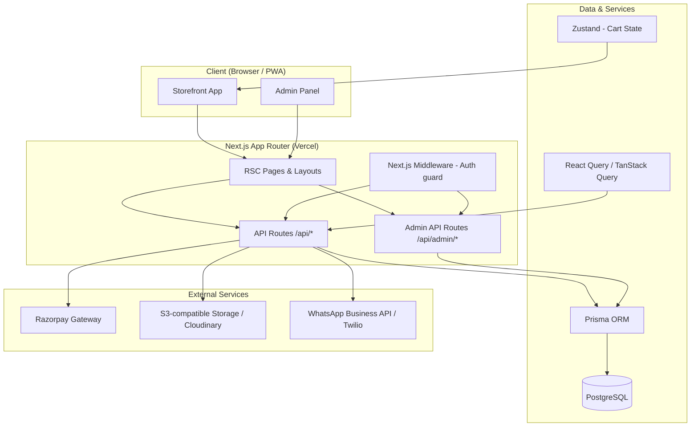
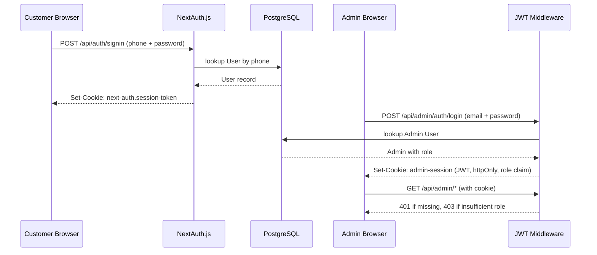
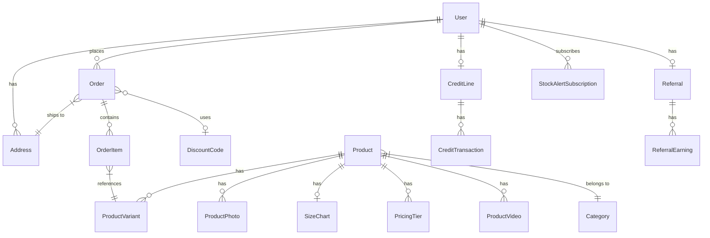
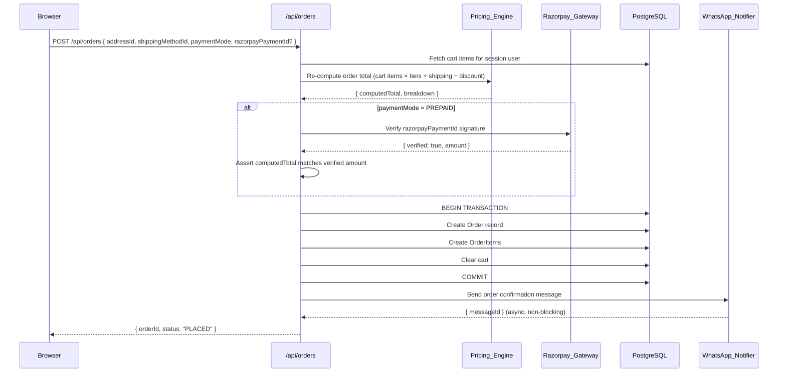
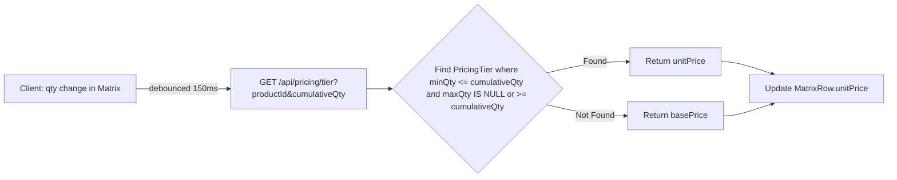
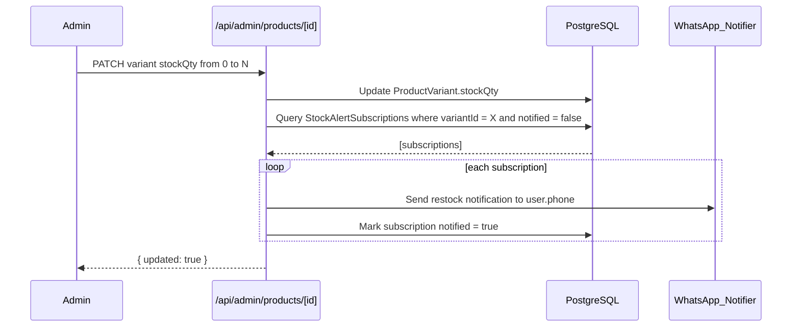

# Design Document — NayaKapda.com B2B Wholesale Platform

## Overview

This document describes the technical architecture, component design, API contracts, data flows, correctness properties, error handling strategy, and testing strategy for **NayaKapda.com** (NayaKapda — The Tshirt Printing Store).

### Brand & Business Specifications
- **Brand Name**: NayaKapda.com
- **Proprietor / Owner**: Mr. Karan Rajput
- **Primary Location**: Shop No-09, Wing-E, PM Avas Yojna, Near Ratri Bazar, New Sama Road, Vadodara, Gujarat - 390008, India
- **WhatsApp Support (Primary)**: +91 8735045268
- **Alternative Phone**: +91 7698752012
- **Official Brand Logo**: `/logo.png` (Horizontal Light Theme Logo — rendered as standalone image, text logo removed)
- **Mobile Navbar Layout**: Hamburger menu toggle is strictly positioned on the LEFT side of the navbar on mobile view.
- **Security Constraint**: Customer login page `/login` MUST NOT show links or entry points to `/admin/login`.

The platform is a full-stack Next.js application deployed to Vercel with PostgreSQL (Neon). It consists of two surfaces: a customer-facing Storefront and a role-gated Admin Panel. The primary ordering mechanism is the Size × Quantity Matrix, providing real-time tier-based pricing, quantity-multiple validation, and bulk cart operations.

---

## Architecture

### High-Level Architecture



### Request Flow

1. Browser sends request to Vercel Edge Network.
2. Next.js Middleware runs: validates session cookie (NextAuth for customers, JWT for admins), redirects unauthenticated requests.
3. React Server Components (RSC) fetch initial data via Prisma directly (server-side).
4. Client components hydrate and use React Query for subsequent fetches.
5. Mutations go through API Routes, which run Zod validation → business logic → Prisma → optional external calls.

### Authentication Architecture



---

## Components and Interfaces

### Frontend Component Tree

```
app/
├── layout.tsx                     # Root layout: Header, Footer, Providers
├── (storefront)/
│   ├── page.tsx                   # Home
│   ├── catalog/page.tsx           # /catalog
│   ├── product/[slug]/page.tsx    # /product/[slug]
│   ├── cart/page.tsx              # /cart
│   ├── checkout/page.tsx          # /checkout
│   ├── account/
│   │   ├── page.tsx               # Order history
│   │   ├── credit-line/page.tsx
│   │   └── referral/page.tsx
│   ├── stock/page.tsx
│   ├── shipping-calculator/page.tsx
│   ├── pricing/page.tsx
│   ├── product-videos/page.tsx
│   └── (static)/                  # contact, about, faq, policy/*, sitemap
├── admin/
│   ├── layout.tsx                 # Admin layout + auth guard
│   ├── page.tsx                   # Dashboard
│   ├── products/
│   ├── categories/
│   ├── orders/
│   ├── customers/
│   ├── discounts/
│   ├── content/
│   └── analytics/
└── api/
    ├── auth/[...nextauth]/route.ts
    ├── products/
    ├── cart/
    ├── pricing/
    ├── orders/
    ├── discount/
    ├── stock/
    ├── shipping/
    ├── account/
    └── admin/
```

### Key Client Components

#### `<ProductMatrix />`

interface ProductMatrixProps {
  productId: string;
  productName: string;
  variants: ProductVariant[];
  sizes: string[];
  colors: string[];
  tiers: PricingTier[];
  basePrice: number;
  qtyMultiple: number;
  categoryId: string;
  productSlug: string;
  productPhotoUrl: string | null;
}

- State: `matrix: Record<string, Record<string, number>>` (color × size → quantity)
- On quantity/color changes: resolved live client-side using `resolveUnitPrice(tiers, totalQty, basePrice)`
- `validateMultiple(qty, multiple): boolean` — pure function, `qty % multiple === 0 && qty > 0`
- On "Add to Cart":
  - If authenticated: POST `/api/cart/bulk-add` (database cart)
  - If unauthenticated (guest): add items directly to local Zustand store (`addGuestItemsBulk`)
- Optimistic cart badge update via Zustand `itemCount`

#### `<CartPage />`

- Reacts to authentication state:
  - If authenticated: fetches cart via `GET /api/cart` (database cart)
  - If unauthenticated (guest): reads directly from Zustand local store (`guestItems`)
- Edits / Updates:
  - If authenticated: `PATCH /api/cart/item/[id]`
  - If unauthenticated: `updateGuestQty(variantId, qty)`
- Deletes / Removes:
  - If authenticated: `DELETE /api/cart/item/[id]`
  - If unauthenticated: `removeGuestItem(variantId)`
- "Proceed to Checkout" button:
  - If authenticated: routes to `/checkout`
  - If unauthenticated: routes to `/login?redirect=/checkout`

#### `<CheckoutPage />`

- Route protected via NextAuth middleware (`/checkout`)
- On successful authentication mount:
  - Checks if `guestItems.length > 0`
  - Automatically merges local items to database via `POST /api/cart/bulk-add`, then clears local guest cart (`clearGuestCart`)
- Multi-step: Address → Shipping → Review → Payment
- Address form with name, phone, line1, city, state, pincode, and country selector. Validates name and 10-digit Indian phone number.
- Order Summary Sidebar shows: total piece count, estimated weight (~250g/piece), taxable subtotal, 5% GST (textile rate), shipping cost, applied discount, and grand total.
- Supports exactly two active shipping methods: Courier (All India through ship rocket) and Self pickup.
- Razorpay: load `razorpay.js` script, open checkout modal on payment step (simulated for testing to place order directly).
- COD and Credit Line / BNPL payment methods are completely removed.
- **Light Theme Design System Architecture**: Simple, modern, light white design system featuring pure white backgrounds (`#ffffff`), soft slate surfaces (`#f8fafc`), clean slate-200 borders (`#e2e8f0`), NayaKapda warm orange primary accents (`#f97316`), and high-contrast slate-900 typography (`#0f172a`).
- **Payment Success Page (`/checkout/success`)**: A clean post-checkout interface displaying a large success checkmark illustration, the Order ID (monospace orange), the detailed ordered items table (variant details, quantity, prices), the final price breakdown (with subtotal, shipping, GST, grand total), and the shipping address contact name/phone.
- **Dynamic Parameter Unwrapping**: To support Next.js 15 App Router standard, all dynamic page route parameters (`params`) in storefront (`/account/orders/[id]`) and admin (`/admin/orders/[id]`) views are treated as Promises and unwrapped asynchronously (via `React.use()` or `await params`).

#### `<Header />` (Navbar)

- Clean light backdrop (`bg-white/95 backdrop-blur-md border-b border-slate-200 text-slate-800`) ensuring seamless visual hierarchy and high readability.
- Slide-out menu (Zustand-controlled open state)
- Cart badge: Zustand `cartItemCount` with crisp orange badge indicator (`bg-orange-500 text-white`)
- Rotating banner: SWR/React Query polling `GET /api/products/stats/units-sold`
- Credit line widget: React Query `GET /api/account/credit-line`

#### `<PWAInstallPrompt />`

- Listens for `beforeinstallprompt` event
- Deferred prompt stored in ref; button click triggers `prompt()`

### Admin Components

#### `<ProductEditor />`

- React Hook Form + Zod resolver
- Photo upload: drag-and-drop via `react-dropzone`, POST to `/api/admin/products/[id]/photos`
- Pricing tier table: `@tanstack/react-table` editable rows

#### `<OrderTable />`

- TanStack Table with server-side pagination/filtering
- Status update: inline dropdown, PATCH `/api/admin/orders/[id]`
- CSV export: triggers GET with `?format=csv`

---

## Data Models

The Prisma schema is the authoritative data model. Below are the key entity relationships and derived types used throughout the application.

### Entity Relationship Diagram



### Derived TypeScript Types

```typescript
// Resolved pricing result
type TierPriceResult = {
  unitPrice: number;
  tierId: string;
  tierMin: number;
  tierMax: number | null;
};

// Bulk add cart payload
type BulkAddPayload = {
  rows: {
    variantId: string;
    qty: number;
  }[];
};

// Cart item with computed fields
type CartItemView = {
  id: string;
  variantId: string;
  productName: string;
  size: string;
  color: string;
  sku: string;
  qty: number;
  unitPrice: number;
  subtotal: number;
  stockQty: number;
};

// Order placement request
type PlaceOrderRequest = {
  addressId: string;
  shippingMethodId: string;
  paymentMode: 'PREPAID' | 'COD';
  discountCodeId?: string;
  razorpayPaymentId?: string;
};

// Pricing tier resolution input
type TierResolutionInput = {
  productId: string;
  cumulativeQty: number;
};
```

---

## API Design

### Authentication

All customer-facing API routes require a valid NextAuth session cookie. Admin routes require the `admin-session` JWT cookie with the appropriate role claim.

### API Route Contracts

#### `GET /api/products`

Query: `?category=&page=&limit=`
Response: `{ products: ProductCard[], total: number, page: number }`

#### `GET /api/products/[slug]`

Response: `{ product: ProductDetail, variants: ProductVariant[], tiers: PricingTier[], photos: ProductPhoto[], sizeChart: SizeChart | null }`

#### `GET /api/pricing/tier`

Query: `?productId=&cumulativeQty=`
Response: `{ unitPrice: number, tierId: string, tierMin: number, tierMax: number | null }`
Validation: `productId` must be a valid cuid; `cumulativeQty` must be a positive integer.

#### `POST /api/cart/bulk-add`

Body: `{ rows: [{ variantId: string, qty: number }] }`
- Server validates: each variantId exists and is active; each qty > 0 and is a valid multiple for the variant's category; re-computes unit prices from PricingTier.
- Response: `{ cartItemCount: number, addedItems: CartItemView[] }`

#### `GET /api/cart`

Response: `{ items: CartItemView[], subtotal: number, itemCount: number }`

#### `PATCH /api/cart/item/[id]`

Body: `{ qty: number }`
- Re-validates multiple and re-prices.
Response: `{ item: CartItemView, cartSubtotal: number }`

#### `DELETE /api/cart/item/[id]`

Response: `{ cartItemCount: number }`

#### `POST /api/discount/validate`

Body: `{ code: string, cartTotal: number, totalQty: number }`
Rate-limited: 20 req/min/IP.
Response: `{ valid: boolean, discount: number, type: 'PERCENT' | 'FLAT', message?: string }`

#### `POST /api/orders`

Body: `PlaceOrderRequest`
- Server re-computes full order total from cart items + PricingTier + discount + shipping.
- If `paymentMode = PREPAID`: verifies `razorpayPaymentId` against Razorpay API.
- Creates Order + OrderItems + CreditTransaction (if credit mode).
- Triggers WhatsApp confirmation.
Response: `{ orderId: string, status: OrderStatus }`

#### `POST /api/shipping/calculate`

Body: `{ pincode: string, totalPieces: number }`
Response: `{ methods: ShippingMethodEstimate[] }`

#### `GET /api/account/credit-line`

Response: `{ limitAmount: number, usedAmount: number, availableAmount: number, transactions: CreditTransaction[] }`

#### `POST /api/account/credit-line/settle`

Body: `{ razorpayPaymentId: string, amount: number }`
Response: `{ newUsedAmount: number, transaction: CreditTransaction }`

#### `GET /api/account/referral`

Response: `{ code: string, referralLink: string, earningsTotal: number, earnings: ReferralEarning[] }`

#### `GET /api/stock`

Response: `{ variants: StockRow[] }` where `StockRow = { variantId, sku, productName, size, color, stockQty, isSubscribed }`

#### `POST /api/stock/alert-subscribe`

Body: `{ variantId: string }`
Response: `{ subscribed: boolean }`

### Admin API Routes (all require STAFF or SUPER_ADMIN unless noted)

#### `GET /api/admin/analytics`

Query: `?from=&to=&groupBy=product|category`
Response: `{ salesTrend: DataPoint[], topProducts: ProductRevenue[], discountReport: DiscountUsage[] }`

#### `GET|POST /api/admin/products`
#### `GET|PATCH|DELETE /api/admin/products/[id]`
#### `POST /api/admin/products/[id]/photos`
#### `GET|POST /api/admin/categories`
#### `GET|PATCH|DELETE /api/admin/categories/[id]`
#### `GET|POST /api/admin/discount-codes` (SUPER_ADMIN only)
#### `GET|PATCH|DELETE /api/admin/discount-codes/[id]` (SUPER_ADMIN only)
#### `GET|POST /api/admin/pricing-tiers` (SUPER_ADMIN only, audit logged)
#### `GET /api/admin/orders`
#### `PATCH /api/admin/orders/[id]`
#### `GET /api/admin/faq`
#### `POST|PATCH|DELETE /api/admin/faq/[id]`
#### `GET|POST /api/admin/shipping-methods`
#### `GET|PATCH|DELETE /api/admin/shipping-methods/[id]`
#### `GET /api/admin/credit-lines` (SUPER_ADMIN only)
#### `PATCH /api/admin/credit-lines/[userId]` (SUPER_ADMIN only, audit logged)

---

## Data Flows

### Order Placement Flow



### Pricing Tier Resolution Flow



### Stock Alert Notification Flow



---

## Correctness Properties

*A property is a characteristic or behavior that should hold true across all valid executions of a system — essentially, a formal statement about what the system should do. Properties serve as the bridge between human-readable specifications and machine-verifiable correctness guarantees.*

### Property-Based Testing Overview

Property-based testing (PBT) validates software correctness by testing universal properties across many generated inputs. Each property is a formal specification that should hold for all valid inputs.

Core principles:
- Universal Quantification: Every property contains an explicit "for all" statement.
- Requirements Traceability: Each property references the requirements it validates.
- Executable Specifications: Properties are implementable as automated tests.
- Comprehensive Coverage: Properties cover all testable acceptance criteria.

Recommended library: `fast-check` (TypeScript/JavaScript).

---

Property 1: Phone number validation rejects invalid formats
*For any* string that is not exactly 10 digits or does not start with 6–9, the Validator SHALL reject it as an invalid phone number and not create a User record.
**Validates: Requirements 1.1, 1.2**

---

Property 2: Quantity multiple validation is symmetric
*For any* category multiple M and any quantity Q, `validateMultiple(Q, M)` returns true if and only if `Q > 0` and `Q mod M === 0`.
**Validates: Requirements 5.3, 6.2**

---

Property 3: Pricing tier resolution is monotonically correct
*For any* product with a set of non-overlapping PricingTiers, and any cumulative quantity Q, the resolved unit price SHALL be the `pricePerPiece` of the tier where `minQty <= Q` and (`maxQty IS NULL` or `maxQty >= Q`). For any two quantities Q1 < Q2 that fall into different tiers, the unit price at Q2 SHALL be less than or equal to the unit price at Q1 (price never increases with higher quantity).
**Validates: Requirements 5.4**

---

Property 4: Server-side total re-computation matches client-expected total
*For any* set of cart items, the server-computed order total (sum of `qty * resolvedUnitPrice` for each item, minus discount, plus shipping) SHALL equal the total that would be produced by applying the same Pricing_Engine logic independently. The system SHALL reject any order where the client-submitted total deviates from the server-computed total.
**Validates: Requirements 8.7, 23.6**

---

Property 5: Bulk-add cart operation is idempotent with respect to quantity multiples
*For any* bulk-add request where all rows have quantities that are valid multiples of their category's `qtyMultiple`, the server SHALL accept the request. *For any* bulk-add request where at least one row has an invalid multiple, the server SHALL reject the entire request.
**Validates: Requirements 5.3, 5.8**

---

Property 6: Discount code validation enforces all constraints simultaneously
*For any* discount code and any order, the code SHALL be considered valid if and only if all of the following hold: the code exists, `active = true`, `expiresAt` is null or in the future, `usedCount < maxUses` (or `maxUses` is null), and the cart's total quantity meets `minOrderQty` (or `minOrderQty` is null). If any single constraint fails, the code SHALL be rejected.
**Validates: Requirements 6.4, 6.5, 20.3, 20.4**

---

Property 7: Credit line invariant — used amount never exceeds limit
*For any* CreditLine, after any sequence of CHARGE and SETTLEMENT CreditTransactions, `usedAmount` SHALL always be greater than or equal to 0 and less than or equal to `limitAmount`. The system SHALL reject a CHARGE transaction that would cause `usedAmount` to exceed `limitAmount`.
**Validates: Requirements 10.2, 10.3, 10.6**

---

Property 8: Stock alert subscriptions are deduplicated per user-variant pair
*For any* user and any ProductVariant, the system SHALL store at most one active StockAlertSubscription. Submitting a second subscription request for the same user-variant pair SHALL return the existing subscription without creating a duplicate.
**Validates: Requirements 12.3, 12.4**

---

Property 9: Order total computation round-trip
*For any* set of OrderItems with associated ProductVariants and PricingTiers, serialising the order to the database and then reading it back SHALL produce OrderItems whose `subtotal` values equal `qty * unitPrice` for each item, and whose sum equals `Order.totalAmount` minus discount and plus shipping cost.
**Validates: Requirements 8.3, 8.7**

---

Property 10: Admin role enforcement is exhaustive
*For any* admin API route that is restricted to SUPER_ADMIN, a request authenticated with a STAFF role JWT SHALL always receive HTTP 403, regardless of request body or method.
**Validates: Requirements 2.3, 2.4, 10.7, 18.3**

---

Property 11: Audit log completeness for sensitive operations
*For any* admin action that modifies a PricingTier, DiscountCode, or CreditLine, the Audit_Logger SHALL produce exactly one audit record containing the admin ID, action type, timestamp, and before/after values.
**Validates: Requirements 16.6, 18.3, 20.5, 23.7**

---

Property 12: Zod schema validation rejects all malformed API inputs
*For any* API route with a defined Zod schema, any request body or query parameter set that violates the schema SHALL receive HTTP 422 with field-level error details, and no database mutation SHALL occur.
**Validates: Requirements 23.1**

---

## Error Handling

### Validation Errors (HTTP 422)

All API routes use a shared `validateRequest(schema, data)` utility that:
1. Runs `schema.safeParse(data)`
2. On failure: returns `{ success: false, errors: ZodError.flatten() }` with HTTP 422
3. On success: returns the parsed, type-safe data

### Authentication Errors

- Missing session: HTTP 401 `{ error: "UNAUTHENTICATED" }`
- Insufficient role: HTTP 403 `{ error: "FORBIDDEN", requiredRole: "SUPER_ADMIN" }`

### Business Logic Errors

- Returned as HTTP 400 with a structured error body: `{ error: string, code: ErrorCode }`
- Defined error codes: `INVALID_QTY_MULTIPLE`, `TIER_NOT_FOUND`, `DISCOUNT_INVALID`, `CREDIT_LIMIT_EXCEEDED`, `ORDER_TOTAL_MISMATCH`, `VARIANT_OUT_OF_STOCK`, `RAZORPAY_VERIFICATION_FAILED`

### External Service Failures

- WhatsApp delivery failures: logged to database (table: `NotificationLog`) with fields: `event`, `userId`, `payload`, `errorCode`, `createdAt`. Never propagates to the HTTP response.
- Razorpay failures: surface as HTTP 400 `{ error: "PAYMENT_FAILED", ... }` to the client.
- S3 upload failures: surface as HTTP 500 with a retry suggestion.

### Database Errors

- Prisma unique constraint violations: mapped to HTTP 409 `{ error: "CONFLICT", field: "..." }`
- Prisma transaction failures: rolled back atomically; return HTTP 500 with a safe error message (no internal details exposed).

### Global Error Boundary

- Next.js `error.tsx` components at route segment level catch React rendering errors.
- API routes wrap handlers in a `withErrorHandler(handler)` HOC that catches unhandled errors and returns HTTP 500 without leaking stack traces.

---

## Testing Strategy

### Dual Testing Approach

Both unit tests and property-based tests are required and complementary:

- Unit tests: verify specific examples, edge cases, error conditions, and integration points.
- Property tests: verify universal properties across randomly generated inputs using `fast-check`.

### Unit Testing

Framework: `Vitest` + `@testing-library/react` for component tests.

Focus areas:
- `validateMultiple` pure function: specific examples (qty=10, multiple=10 → valid; qty=11 → invalid)
- `Pricing_Engine.resolvePrice`: specific tier boundary examples
- Discount code validation: each failure mode as a separate test case
- Admin role middleware: specific role/route combinations
- Zod schemas: specific valid and invalid payloads
- React components: render output for specific prop combinations

### Property-Based Testing

Framework: `fast-check` with minimum 100 iterations per property.

Each property test maps to a property in the Correctness Properties section. Tag format:
`// Feature: b2b-wholesale-apparel-platform, Property N: <property_text>`

Key generators needed:
- `fcPhone()` — arbitrary strings to test validation
- `fcValidPhone()` — valid Indian phone numbers
- `fcQty(multiple)` — valid multiples for a given category
- `fcPricingTiers()` — non-overlapping PricingTier arrays
- `fcCartItems(tiers)` — cart items consistent with existing tiers
- `fcAdminRole()` — STAFF or SUPER_ADMIN
- `fcCreditLine()` — CreditLine with arbitrary limit and used amounts

### Test Configuration

```typescript
// vitest.config.ts
export default defineConfig({
  test: {
    globals: true,
    environment: 'node',       // for API route tests
    environmentMatchGlobs: [
      ['**/*.component.test.tsx', 'jsdom'],
    ],
  },
});
```

Property tests run in CI with `--run` flag (no watch mode).
Minimum 100 iterations: `fc.assert(fc.property(...), { numRuns: 100 })`.

### Test File Organisation

```
src/
├── lib/
│   ├── pricing.test.ts           # Unit + property tests for Pricing_Engine
│   ├── validation.test.ts        # Unit + property tests for Validator/Zod schemas
│   └── cart.test.ts              # Unit tests for cart operations
├── components/
│   └── ProductMatrix.component.test.tsx
└── app/api/
    ├── cart/bulk-add.test.ts
    ├── orders/place-order.test.ts
    └── discount/validate.test.ts
```
